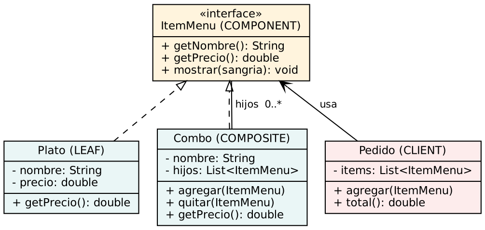

# DP-2026-Grupo5-PedidosCeviche

## Integrantes
| Nombre | Código UTP | Usuario GitHub | Rol |
|---|---|---|---|
| Dandy Alexandre Abadie Atoche | U23217843 | @DandyXandy | Coordinación y documentación |
| Axel Samir Ojeda Paredes | U24252010 | @SamirOFL | Pedido, Main y UML |
| Any Yanela Raymundo Ancajima | U24252130 | @DiegoAPCh | ItemMenu y hojas (Plato) |
| Diego Armando Prieto Chavez | U24232045 | @AnyRaymundo | Combo (Composite) |

**Grupo:** 5

## Problema que resuelve
Una cevichería vende platos sueltos y combos. Los combos pueden contener platos
y también otros combos. Sin un diseño adecuado, calcular el total o mostrar el
pedido obliga a revisar el tipo de cada ítem (`instanceof`) y el código se rompe
cada vez que aparece un nuevo tipo de combo.

## Patrón aplicado
- **Nombre:** Composite
- **Tipo:** Estructural
- **Problema que resuelve:** tratar de forma uniforme objetos individuales y
  agrupaciones de objetos (estructura de árbol).
- **Clases que participan:**
  - `ItemMenu` — Component
  - `Plato` — Leaf
  - `Combo` — Composite
  - `Pedido` / `Main` — Client

## Diagrama de clases

## Capturas de pantalla
(pendiente)

## Estado (avance 50 %)
- [x] Repositorio y estructura inicial
- [x] Diagrama de clases preliminar
- [ ] Implementación del patrón (en curso)
